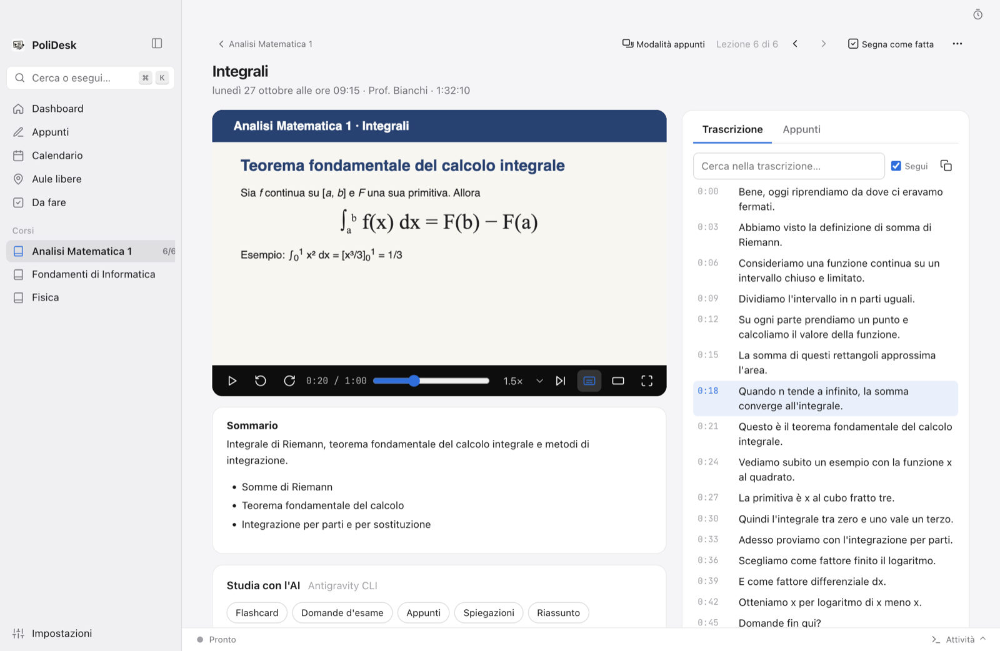
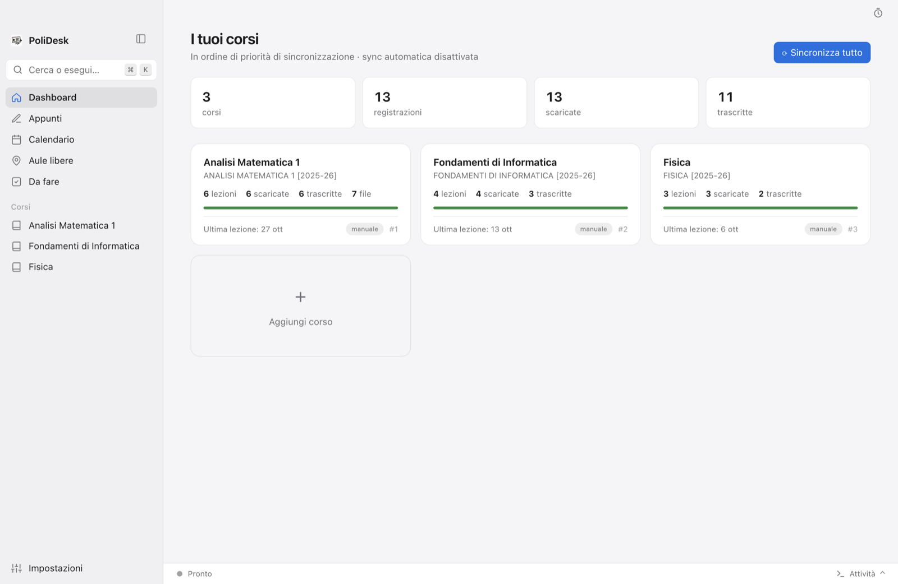
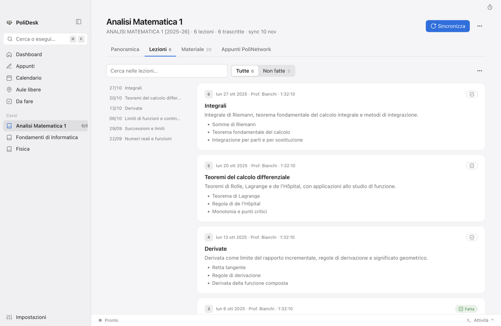
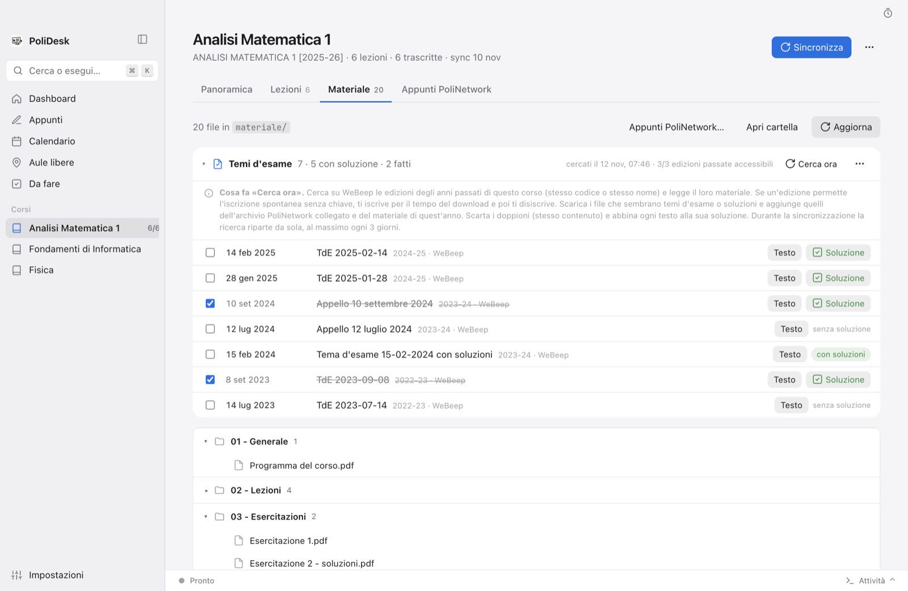
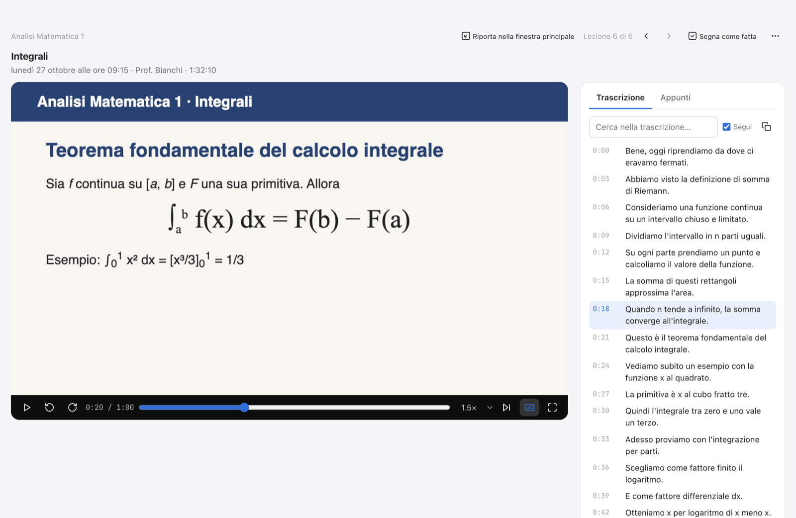

<p align="center"></p>

# PoliDesk

**Le lezioni del Politecnico di Milano, sul tuo computer: scaricate, trascritte e pronte da studiare.**

App desktop gratuita e open source per macOS, Windows e Linux. Trova le registrazioni dei tuoi corsi WeBeep,
le scarica, le trascrive in locale e ti aiuta a studiarle: appunti, flashcard, domande d'esame, ricerca nei contenuti,
calendario, aule libere e Pomodoro, tutto in un'unica app.

[](LICENSE)


> **App non ufficiale**, non affiliata né approvata dal Politecnico di Milano. Usa le registrazioni solo per
> studio personale e nel rispetto del regolamento di Ateneo. Vedi [Privacy e uso responsabile](PRIVACY.md).

<p align="center"></p>

---

## Cosa fa

| | |
|---|---|
| **📥 Registrazioni** | Trova le lezioni ovunque siano nel corso WeBeep (archivi RecMan, link WebEx, annunci, mp4, YouTube) e le scarica in parallelo. Sincronizzazione automatica all'avvio, con coda di priorità tra i corsi. |
| **👥 Lezioni parallele** | Se un corso ha le registrazioni di più docenti, ti chiede quale segui prima di scaricarle (anche più di uno). |
| **🎙 Trascrizione locale** | Whisper large-v3-turbo o Parakeet, configurati in automatico per il tuo hardware (Apple Silicon, NVIDIA, solo CPU). Toglie ehm, mmm, ripetizioni e frasi inventate. L'audio non lascia il computer. |
| **▶ Pagina della lezione** | Player interno (velocità fino a 3×, salto dei silenzi, ripresa automatica), trascrizione sincronizzata, cercabile e copiabile, anche sotto il video a schermo intero. Modalità cinema e **modalità appunti** (la lezione in una finestra separata). |
| **✨ Studia con l'AI** | Per ogni lezione: sommario, appunti, riassunto, spiegazioni, **flashcard interattive**, **domande d'esame**, chat sulla lezione. Usa Antigravity CLI, Claude Code, GitHub Copilot CLI, ChatGPT Codex CLI o OpenCode, con il modello che scegli, anche **modelli locali con Ollama** (nulla esce dal computer); se finiscono i crediti cambia modello, strumento o aspetta il reset. |
| **📝 Temi d'esame** | Cerca il corso negli anni passati su WeBeep e PoliNetwork e scarica i temi d'esame con le soluzioni, senza doppioni, in ordine di data. Segna quelli fatti. |
| **🔎 Ricerca semantica** | Cerca per significato in lezioni, slide e appunti (anche tra lingue diverse) e chiedi al corso, con risposte citate. Tutto in locale. |
| **✎ Appunti** | Markdown, LaTeX o Typst (motori inclusi), con anteprima, assistente AI che propone modifiche da accettare una a una, dettatura vocale. Organizzati per corso e cartelle nella barra laterale; carica PDF, foto e documenti o **collega intere cartelle** del computer (non vengono copiate: restano sincronizzate). Collegabili a una o più lezioni. |
| **📅 Studio** | Orario delle lezioni dai Servizi Online, calendario, **aule libere con mappa**, cose da fare, Pomodoro con statistiche. |
| **☁ Sync e integrazioni** | Appunti e impostazioni su iCloud, Google Drive, Dropbox o OneDrive. Esporta in Notion, Note di Apple, Goodnotes, Notability, Obsidian. |
| **🤖 Assistenti AI e script** | Server **MCP** e **riga di comando** per usare PoliDesk da Claude o dal tuo flusso di lavoro. |

## Screenshot

| | |
|---|---|
|  |  |
| **Dashboard**: i tuoi corsi, lezioni scaricate e trascritte. | **Lezioni**: sommario di ogni lezione, filtri, lezioni segnate come fatte. |
|  |  |
| **Materiale e temi d'esame**: cartelle del corso e PoliNetwork, temi d'esame degli anni passati con le soluzioni. | **Modalità appunti**: video e trascrizione in una finestra a parte, mentre prendi appunti nell'altra. |

<sub>Dati di esempio: corsi e lezioni negli screenshot sono inventati.</sub>

## Installazione

1. Scarica l'installer dalla pagina **[Releases](../../releases)**:
   - **macOS**: `.dmg` (Apple Silicon `arm64` o Intel);
   - **Windows**: `PoliDesk-Setup-….exe`;
   - **Linux**: `.AppImage` o `.deb`.
2. Serve **Google Chrome** installato: il login PoliMi/SPID avviene in una sua finestra, sui siti ufficiali.
3. Al primo avvio il **setup** analizza il computer e installa il motore di trascrizione più adatto (qualche minuto).

> **macOS**: l'app non è firmata con un certificato Apple. La prima volta aprila con *tasto destro → Apri*.
> **Windows**: se compare SmartScreen scegli *Ulteriori informazioni → Esegui comunque*.

Dettagli e requisiti nella wiki: **[Installazione e primo avvio](docs/wiki/Installazione-e-primo-avvio.md)**.

## Come si usa, in breve

1. **＋ Aggiungi corso**: incolla il link WeBeep (anche di una sezione), il codice o il nome, e scegli la cartella.
2. **⟳ Sincronizza**: PoliDesk trova le registrazioni e le scarica. La prima volta si apre Chrome per il login.
3. Le lezioni vengono **trascritte** e **riassunte** in automatico. Apri una lezione per guardarla, leggere la trascrizione
   e studiare con flashcard, domande e chat.
4. Premi **⇧⌘P** (o **⌘K**) per la command palette: cerca ovunque, crea appunti, cambia tema, sincronizza.

Guida completa: **[wiki](docs/wiki/Home.md)**.

## PoliDesk dal tuo assistente AI o dal terminale

Attiva **Impostazioni → Assistenti AI e automazioni → Assistenti AI (MCP)**, poi:

```bash
# Claude Code: un clic su «Aggiungi a Claude Code», oppure
claude mcp add polidesk --scope user -- <cartella dell'app>/bin/polidesk mcp

# riga di comando (l'alias esatto si copia dalle Impostazioni)
polidesk lessons ANN                         # lezioni del corso con sommario
polidesk transcript ANN 3 > lezione3.txt     # trascrizione senza tempi
polidesk search "vanishing gradient"         # ricerca semantica
polidesk ask "come funziona il dropout?" --course ANN
polidesk rooms --from 14:00 --hours 2        # aule libere
```

23 strumenti MCP e tutti i comandi: **[Server MCP](docs/wiki/Server-MCP.md)** · **[Riga di comando](docs/wiki/Riga-di-comando.md)**.

## Documentazione

| Pagina | Contenuto |
|---|---|
| [Installazione e primo avvio](docs/wiki/Installazione-e-primo-avvio.md) | Requisiti, setup della trascrizione, dove finiscono i file |
| [Guida all'app](docs/wiki/Guida-all-app.md) | Corsi, lezioni, studio con l'AI, appunti, calendario, aule, impostazioni |
| [Scorciatoie e command palette](docs/wiki/Scorciatoie-e-command-palette.md) | Tutte le scorciatoie da tastiera e i comandi della palette |
| [Riga di comando](docs/wiki/Riga-di-comando.md) | Riferimento completo della CLI `polidesk` |
| [Server MCP](docs/wiki/Server-MCP.md) | Collegare Claude Code, Claude Desktop e altri assistenti; elenco degli strumenti |
| [Sviluppo](docs/wiki/Sviluppo.md) | Avvio da sorgente, struttura del codice, test, build e rilascio |
| [Risoluzione dei problemi](docs/wiki/Risoluzione-dei-problemi.md) | Login, download, trascrizione, AI, MCP |

## Sviluppo

```bash
git clone https://github.com/tommaso-dognini/polidesk.git && cd polidesk
npm install
npm start               # avvia l'app (compila editor e backend Rust)
npm run cli -- help     # riga di comando
npm run dist:mac        # installer (anche dist:win, dist:linux)
```

Requisiti: Node.js 22+, Rust (stable, via [rustup](https://rustup.rs)), Google Chrome. Struttura del codice, test con dati isolati (`POLIDESK_HOME`) e rilascio:
**[Sviluppo](docs/wiki/Sviluppo.md)**.

## Contribuire

I contributi sono benvenuti: segnalazioni di bug, idee, documentazione e codice.

1. Apri una [issue](https://github.com/tommaso-dognini/polidesk/issues) per segnalare un problema o proporre un'idea
   (per le modifiche grandi, parliamone prima di scrivere codice).
2. Fai un fork, crea un branch dal `main` e fai le prove con dati isolati (`POLIDESK_HOME=/tmp/polidesk-test npm start`).
3. Controlla che `cargo build && cargo test` passino e apri una pull request che spieghi cosa cambia e perché.

Guida completa, stile e regole (privacy, uso responsabile, licenze): **[CONTRIBUTING.md](CONTRIBUTING.md)**.
Inviando un contributo accetti che sia distribuito con la licenza del progetto (GPL-3.0-or-later).

## Privacy

Tutto resta sul tuo computer: PoliDesk non ha server e non raccoglie statistiche. La password PoliMi non passa mai
dall'app. Il testo arriva a un servizio esterno solo quando usi le funzioni AI, ed è inviato allo strumento che hai scelto.
Dettagli in [PRIVACY.md](PRIVACY.md).

## Crediti

PoliDesk nasce da [PoliWebex](https://github.com/sup3rgiu/PoliWebex) (sup3rgiu, MIT) e dai progetti della community
studentesca raccolti da [PoliNetwork](https://polinetwork.org/it/projects/): polimi-schedule-js, PoliAule, @alpolimibot,
WeBeepSync, PoliMi Webex Enhancer e altri. Elenco completo, con licenze e uso, in [NOTICE.md](NOTICE.md) e nella pagina
*Community* dell'app.

## Licenza

PoliDesk è software libero, distribuito con licenza **[GNU GPL v3.0 o successiva](LICENSE)** (`GPL-3.0-or-later`).

In breve:
- puoi usarlo, studiarlo, modificarlo e ridistribuirlo liberamente;
- chi distribuisce una versione modificata deve rilasciarla con la stessa licenza e con il codice sorgente,
  così l'app resta gratuita e aperta per tutti gli studenti.

Il codice derivato da PoliWebex conserva la sua nota di copyright MIT (`legacy/LICENSE`). I componenti di terze parti
mantengono le proprie licenze (vedi [NOTICE.md](NOTICE.md)).

## Supporta il progetto

PoliDesk è e resterà gratuito. Se ti è utile, puoi offrire un caffè ☕ dal pulsante nell'app, segnalare problemi
o contribuire con una pull request.
